# k-cal - Your Effortless Calorie Tracking Companion

k-cal is a user-friendly iOS app designed to simplify your calorie tracking journey, a free alternative to myfitnesspal. With a seamless interface and powerful features, k-cal empowers you to achieve your health and fitness goals with ease.
Free, no tracking, no subscriptions.

<table style="border-collapse: collapse; border: none;">
  <tr>
    <td style="border: none;">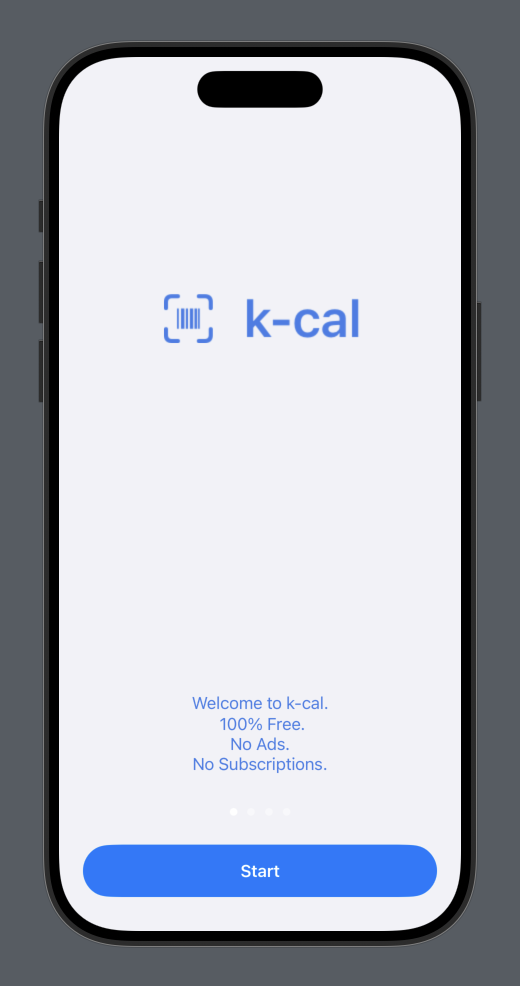</td>
    <td style="border: none;">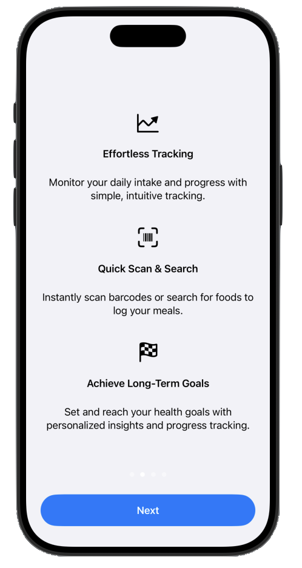</td>
    <td style="border: none; padding-top: 15px;">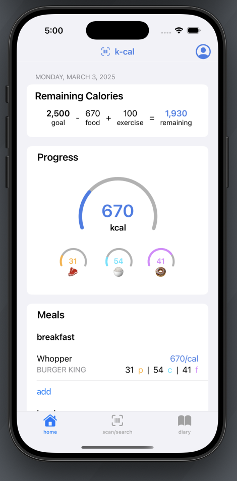</td>
    <td style="border: none;">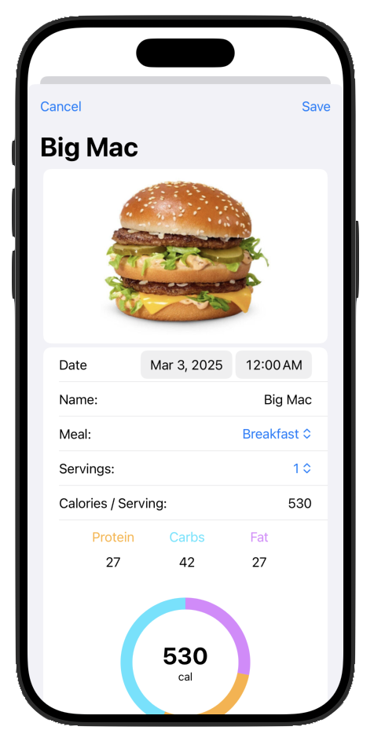</td>
  </tr>
  
</table>

## Food data

No API keys are needed. Foods live on the device, in `k-cal/Data/foods.sqlite` (over 1 million foods, built by `tools/food_database/build.py` from USDA FoodData Central, Open Food Facts and Health Canada's Canadian Nutrient File). A food that isn't there is looked up on Open Food Facts and kept. New products arrive through the app's food update, from the daily files Open Food Facts publishes: automatically on Wi-Fi, or from Food Database in the profile. The database is stored with Git LFS.

Home Screen and Lock Screen widgets live in `k-calWidgets`. The app shares today's totals with them through the `group.rizig.k-cal` App Group.

The meal-photo models also run on the device. To rebuild them, see `tools/meal_estimate/convert.py`.

## Key Features

### 1. Seamless Meal Tracking

Effortlessly log your meals with k-cal's intuitive interface. Add items, adjust quantities, and keep a clear record of your daily intake.

<table style="border-collapse: collapse; border: none;">
  <tr>
    <td style="border: none;">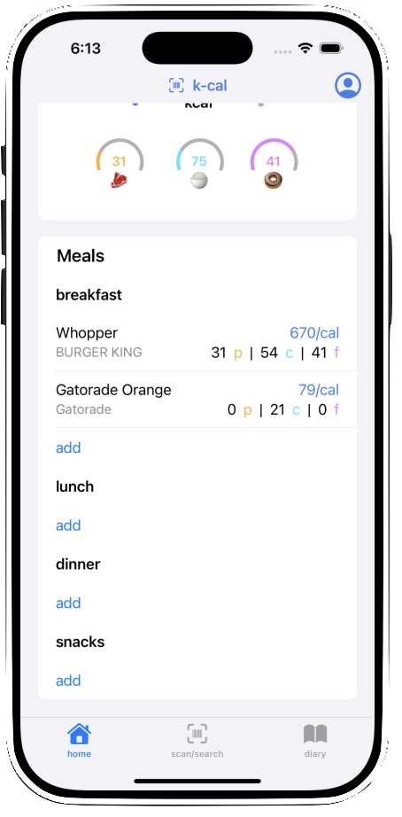</td>
    <td style="border: none;">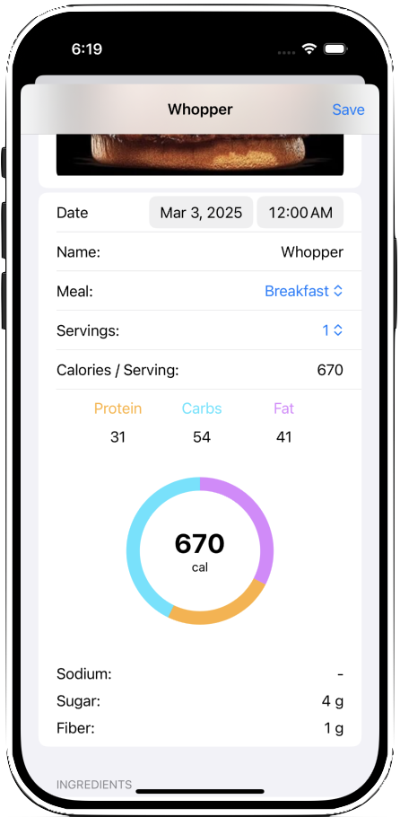</td>
    <td style="border: none;">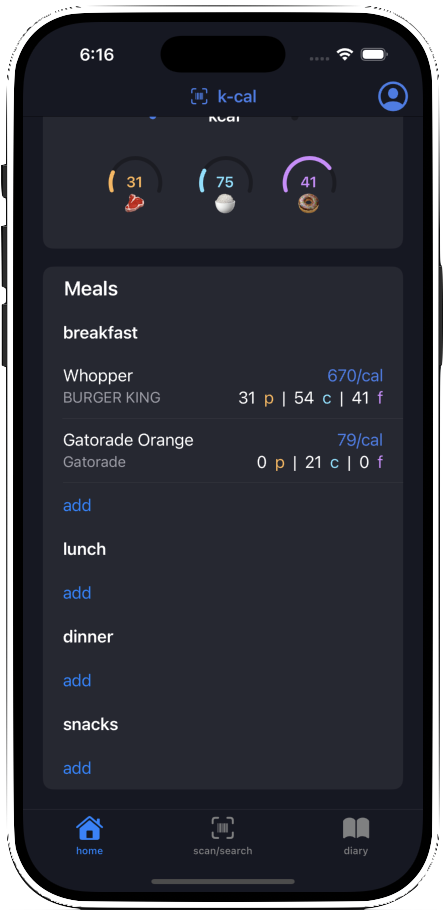</td>
    <td style="border: none;">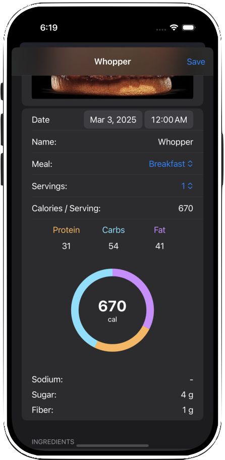</td>

  </tr>
  
</table>

### 2. Barcode Scanning with Access to Over 3 Million Foods

Quickly and accurately log packaged foods using k-cal's integrated barcode scanner. Access a vast database of over 3 million food items, saving you time and ensuring accurate calorie counts.

<table style="border-collapse: collapse; border: none;">
  <tr>
    <td style="border: none;">Instantly Scan Barcodes </td>
    <td style="border: none;">Search 3M+ Foods</td>
    <td style="border: none;">Quick-Add Recent Foods</td>
    <td style="border: none;">Edit/Add/Delete Foods</td>

  </tr>
  <tr>
    <td style="border: none;">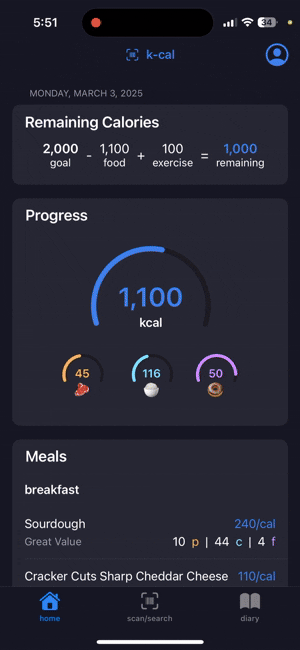</td>
    <td style="border: none;">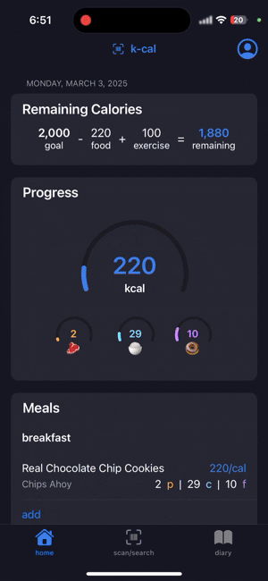</td>
    <td style="border: none;">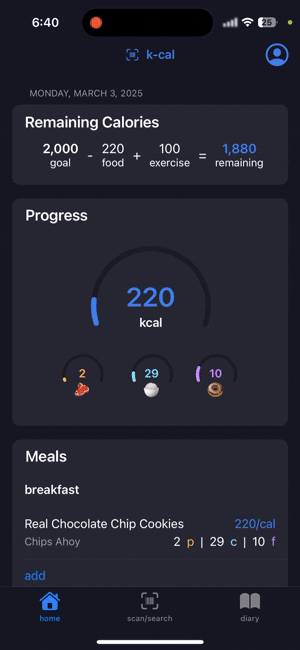</td>
    <td style="border: none;">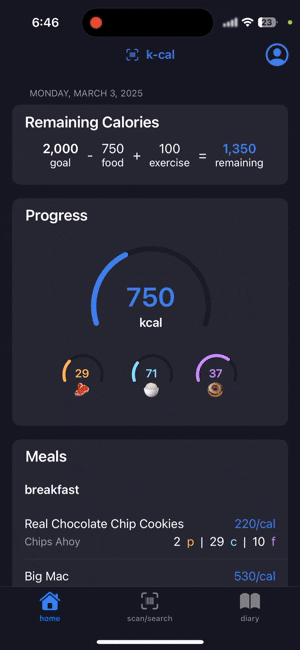</td>

  </tr>
  
  
</table>

### 3. Real-Time Goal Updates

Stay motivated and on track with real-time updates on your progress. k-cal provides clear visualizations of your calorie intake, helping you make informed decisions and stay within your daily goals.

### 4. Effortless Search 3M+ Brands

Find specific food items quickly and easily with k-cal's powerful search functionality. Filter by category, brand, or keyword to streamline your meal logging process.

### 5. Customizable Daily Goals

Tailor k-cal to your individual needs by setting personalized daily calorie goals. Adjust your targets based on your activity level and fitness objectives.

### 6. SwiftData Persistence

k-cal utilizes SwiftData for efficient and reliable data storage. Your meal logs and progress are securely saved, ensuring you never lose your valuable tracking information.

## Technologies Used

* **SwiftUI:** For building the user interface declaratively.
* **SwiftData:** For persistent data storage and management.
* **AVFoundation:** For barcode scanning and camera integration.
* **Open Food Facts API:** For accessing a vast food database.
* **UIKit (via UIViewControllerRepresentable):** For integrating custom view controllers for barcode scanning.

## Try it out!
### Option 1: Download from the IOS AppStore
(In progress)
### Option 2: Direct Compile
1.  Clone the repository: `git clone https://github.com/michaelrzg/k-cal.git`
2.  Open the project in Xcode.
3.  Build and run the app on your iOS device or simulator.

